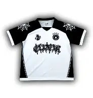
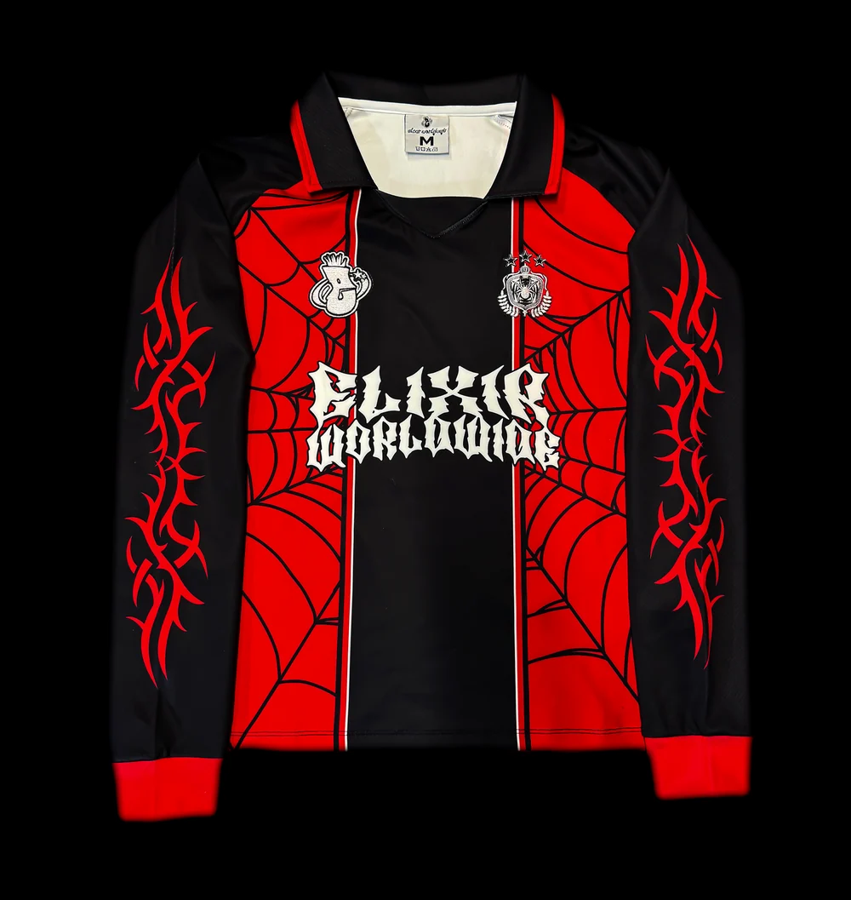
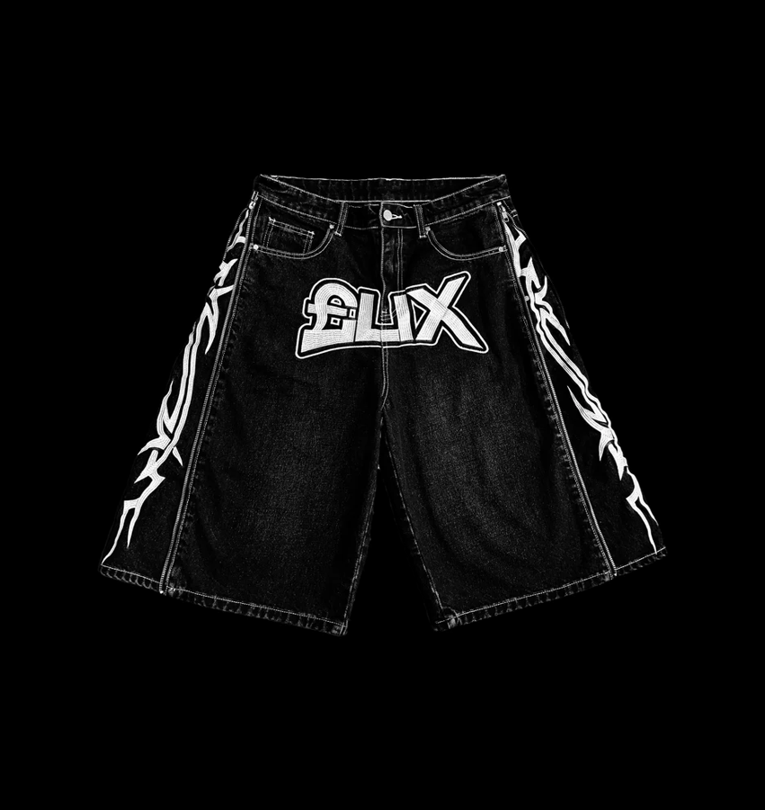

# 👕 Portafolio de Proyecto Web: Elixir

**Estudiante:** [Jefferson Alejandro Sixco Medrano]
**Fecha:** [23/10/2026]
**Enlace al Sitio Web (Vercel):** https://vercel.com/jefferson-s-projects8/elixir/3t7XQwZvzykpCej4WP78yFn82n8r
**Repositorio GitHub:** git@github.com:jeffersonsixco30-max/Elixir.git

---

## 1. Identidad de Marca y Producto

### 🛍️ Ficha del Producto
* **Nombre Comercial:** Elixir
* **Descripción:** Marca de ropa streetwear con estampados góticos, telarañas y diseños tribales. La colección incluye jerseys y jorts en negro, blanco y rojo.
* **Público Objetivo:** Jóvenes de 15 a 30 años aficionados al streetwear y a la moda alternativa.
* **Propuesta de Valor:** Diseños originales y únicos, hechos para destacar y expresar personalidad.

### 🎨 Diseño Visual
* **Logotipo:** la letra E dentro de un círculo negro con borde turquesa.


* **Paleta de Colores:**

| Color | Código HEX | Uso en el Sitio | Justificación |
| :--- | :--- | :--- | :--- |
| Negro | `#111111` | Fondo del hero y de las imágenes | Elegancia, misterio y fuerza, típico del streetwear |
| Blanco | `#F5F5F5` | Textos y contraste | Limpieza visual y contraste |
| Azul oscuro | `#172B3A` | Barra de navegación y footer | Profundidad y confianza |
| Turquesa | `#2DD4BF` | Botones y enlaces activos | Energía y modernidad |

* **Colección de productos:**

| Producto | Imagen |
| :--- | :--- |
| Jersey Web |  |
| Jersey Worldwide |  |
| Jorts Tribal |  |

* **Demostración del Carousel (Bootstrap) con efecto crossfade:**


---

## 2. Investigación Técnica

Resumen de las subpáginas informativas creadas:

1. **JavaScript (Vanilla):** lenguaje que da comportamiento a la página. HTML es la estructura, CSS el estilo y JS el comportamiento. Se vieron variables, funciones y eventos, con un ejemplo de contador de clicks.
2. **jQuery:** librería de JavaScript creada en 2006 por John Resig para simplificar el manejo del DOM. Usa el símbolo `$`. Ventaja: código más corto y efectos fáciles como `fadeToggle` y `slideToggle`. Desventaja: pesa más y el JavaScript moderno ya hace casi lo mismo. La página incluye una tabla comparativa JS vs jQuery.
3. **JSON:** formato de texto ligero para intercambiar datos mediante pares clave-valor, objetos y arreglos. Se compara un objeto JS con una cadena JSON y se explica `JSON.stringify` y `JSON.parse`. Las aplicaciones lo usan con `fetch()` para comunicarse con servidores y APIs.
4. **Web Hosting y Dominios:** tipos de hosting (compartido, VPS y nube), cómo Vercel despliega sitios estáticos desde GitHub, qué es un dominio, un TLD y un subdominio, y cómo funciona la propagación DNS.
5. **IA de Google (15 herramientas gratuitas):**

| Herramienta | Para qué sirve |
| :--- | :--- |
| Google Drive | Almacenamiento en la nube |
| Google Docs | Procesador de texto colaborativo |
| Google Sheets | Hojas de cálculo |
| Google Slides | Presentaciones |
| Google Forms | Encuestas y exámenes |
| Gmail | Correo electrónico |
| Google Calendar | Agenda y recordatorios |
| Google Meet | Videollamadas |
| Google Keep | Notas rápidas |
| Google Sites | Páginas web sin código |
| Google Colab | Programar Python en la nube |
| Looker Studio | Paneles de datos |
| NotebookLM | Asistente de estudio con IA |
| Google Translate | Traductor |
| Google Earth | Mapas 3D |

Las herramientas se seleccionaron por su utilidad para estudiar, crear y trabajar en equipo sin costo.

---

## 3. Integraciones Especiales

### 💬 Formulario de Contacto + Webhook de Discord
1. El usuario completa el formulario (nombre, correo y mensaje) construido con componentes de Bootstrap.
2. Al presionar "Enviar", JavaScript ejecuta una petición asíncrona (`fetch`) con método POST hacia la URL del Webhook de Discord, enviando los datos en formato JSON.
3. La notificación aparece de inmediato en el canal de Discord y el usuario ve una alerta de confirmación.

### 🌙 Modo claro y oscuro
Botón en la barra de navegación que cambia el tema con el atributo `data-bs-theme` de Bootstrap 5.3. La elección se guarda en `localStorage` para mantenerla al cambiar de página.

### 🌐 Cambio de idioma español / inglés
Botón EN/ES en la barra de navegación que traduce todo el sitio usando Google Translate. El logo, el nombre de la marca y los bloques de código no se traducen.

### ✨ Interfaz y animaciones
* Bootstrap 5 para el diseño responsive (menú, rejilla y tarjetas).
* Carousel de Bootstrap con efecto crossfade.
* JavaScript para suavizar la navegación (scroll suave) y animar la aparición de secciones al hacer scroll.
* Tarjetas con efecto al pasar el mouse.

### 📝 Cuestionario interactivo
Sección "Quiz de Conocimientos Web" con 8 preguntas de opción múltiple y verdadero/falso basadas en las páginas investigadas. Al calificar muestra en verde la respuesta correcta, en rojo las incorrectas y el puntaje final.

### 📚 Recursos y bibliografía
Página `recursos.html` con las fuentes consultadas: MDN Web Docs, W3Schools, jQuery, json.org, Vercel Docs, Bootstrap, GitHub Docs, Discord Webhooks y Google Workspace.

---

## 4. Anexos y Evidencias Gráficas

### Anexo 1: Integración con Discord (Formulario vs. Recepción)


### Anexo 2: Despliegue Exitoso en Vercel


### Anexo 3: Diseño Responsive y Bootstrap


### Anexo 4: Cuestionario Interactivo en Funcionamiento


### Anexo 5: Estructura del Repositorio en GitHub


---

## 5. Estructura del Proyecto

```
├── css/
│   └── estilos.css
├── js/
│   ├── script.js
│   └── cuestionario.js
├── assets/
├── index.html
├── javascritpt.html
├── jquery.html
├── json.html
├── hosting.html
├── herramientas.html
├── cuestionario.html
├── recursos.html
└── README.MD
```

---

## 6. Conclusiones y Autoevaluación

* **Desafíos enfrentados:** organizar todo el proyecto en poco tiempo, configurar el webhook de Discord y hacer que el cambio de idioma funcionara con Google Translate.
* **Aprendizajes clave:** uso de Bootstrap 5 (carousel, tarjetas, formularios y modo oscuro), JavaScript para animaciones y consumo de servicios con `fetch`, documentación en Markdown, y publicación con GitHub y Vercel.